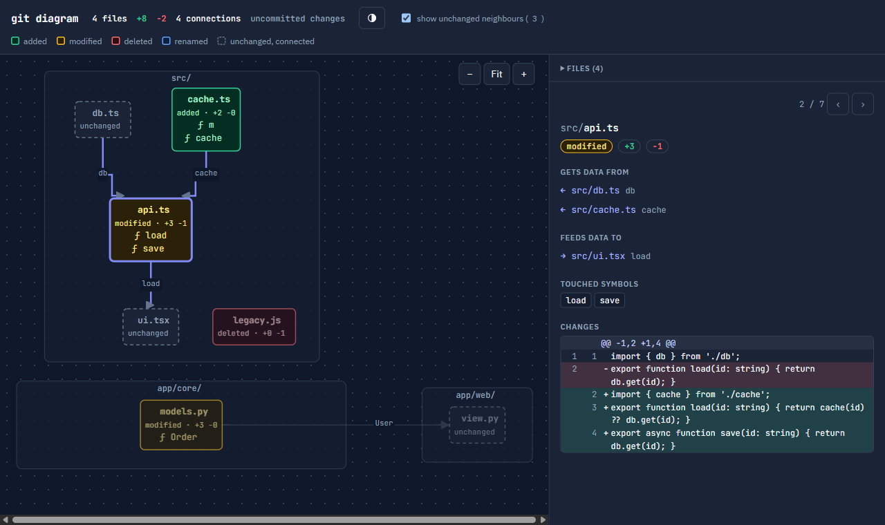
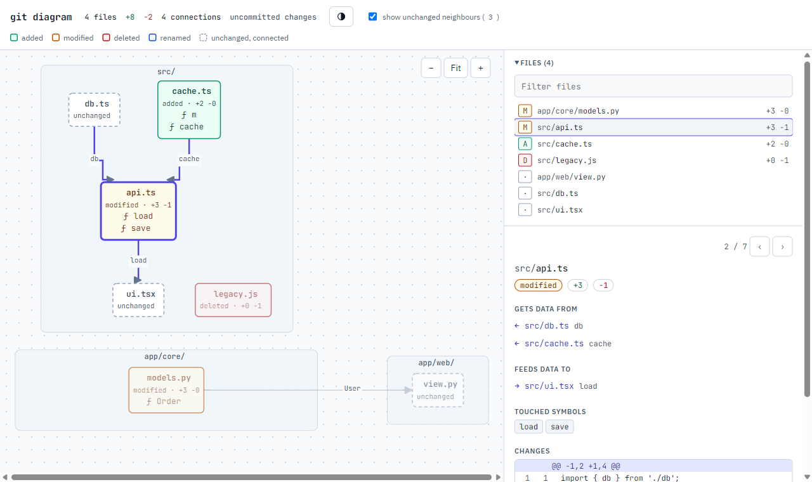
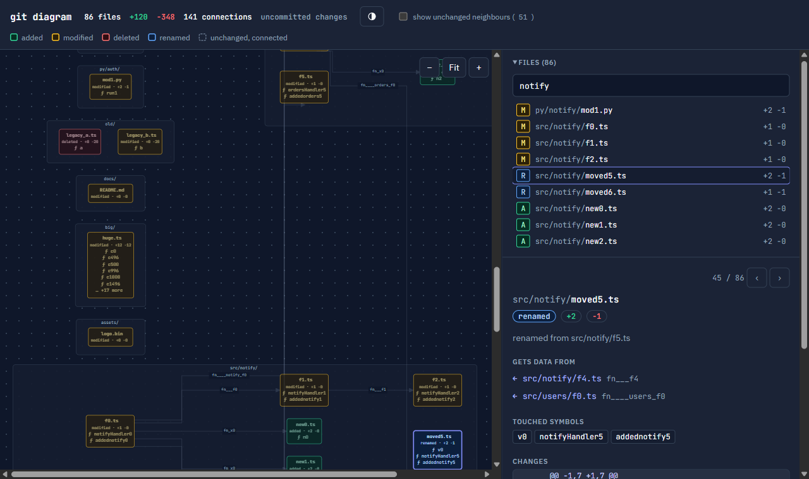

# git diagram

[](https://www.npmjs.com/package/@hiimak/git-diagram)
[](https://github.com/hiimak/git-diagram/actions/workflows/ci.yml)
[](LICENSE)

**See a big diff as a picture before you read it line by line.**

`git diagram` turns your changes into an interactive diagram in the browser: one box per changed file, arrows showing which files feed data into which, and a click on any box shows that file's diff.



## Why this exists

AI coding tools can change 40 files in one go. Reading that as a flat, alphabetical, line-by-line diff does not work: you can't see what the change *is*, only what it touches.

Reviewers need the shape of the change first:

- Which files are new, changed, deleted or renamed?
- How do they depend on each other? If `db.ts` changed, what else relies on it?
- Which functions and classes were touched?
- Where do I need to read closely, and what can I skim?

`git diagram` answers these in one glance and then lets you drill into any file. It looks a bit like a UML or BPMN diagram: folders are lanes, files are boxes, arrows are data flow.

## Install

You need [Node.js](https://nodejs.org) 20 or newer and Git. The command is `git-diagram`, which Git automatically exposes as `git diagram`.

### npm (Linux, macOS, Windows)

```bash
npm install -g @hiimak/git-diagram
```

pnpm, yarn and bun work too (`pnpm add -g @hiimak/git-diagram`, `bun add -g @hiimak/git-diagram`). To try it without installing:

```bash
npx @hiimak/git-diagram
```

### Homebrew (macOS, Linux)

```bash
brew tap hiimak/git-diagram https://github.com/hiimak/git-diagram
brew install --HEAD git-diagram
```

### Windows

Install Node once (`winget install OpenJS.NodeJS.LTS` or `scoop install nodejs-lts`), then use the npm command above.

### Linux

Install Node from your package manager (`sudo apt install nodejs npm`, `sudo dnf install nodejs`, `sudo pacman -S nodejs npm`) or from [nodejs.org](https://nodejs.org), then use the npm command above.

### From a clone

```bash
git clone https://github.com/hiimak/git-diagram.git
cd git-diagram
npm install -g .
```

> Tested: installing from npm on Windows. The Homebrew formula and the Linux/macOS commands are written but not yet run on those systems.

## Use

Run it inside any Git repository. A page opens in your default browser.

```bash
git diagram                  # everything not committed yet (staged, unstaged and new files)
git diagram --cached         # only what is staged
git diagram HEAD~3           # the last 3 commits plus what is uncommitted
git diagram main...HEAD      # everything on this branch since it left main
git diagram v1.2.0 v1.3.0    # between two tags
git diagram -i dist -i '*.lock'   # leave out the dist folder and all lock files
```

It prints where the page is, so you can open it yourself if no browser pops up (for example over SSH):

```text
git diagram: 4 changed files, 4 connections
Opening it in your browser. If nothing opens, follow this link:
  file:///home/you/project/.git/git-diagram.html
```

Anything you pass is handed to `git diff`, so any range that works there works here. Your index and files are never modified.

### Ignoring files

`-i <pattern>` (or `--ignore <pattern>`) leaves matching files out completely. Repeat it for more patterns. Patterns work like `.gitignore`:

| Pattern | Leaves out |
| --- | --- |
| `dist` | every file or folder named `dist`, at any depth, with everything inside it |
| `'*.lock'` | every `.lock` file, at any depth |
| `src/generated` | that one folder (a pattern with a `/` starts at the repository root) |
| `'src/**/*.gen.ts'` | `.gen.ts` files anywhere under `src` (`**` spans folders) |

Quote patterns with `*` so your shell does not expand them. Ignored files are never read, which also makes huge untracked folders fast to skip.

## Reading the diagram

| Colour | Meaning |
| --- | --- |
| Green | added |
| Amber | modified |
| Red | deleted |
| Blue | renamed (the detail panel shows the old name) |
| Grey, dashed | not changed, but connected to a changed file |

- **Arrows** point in the direction data flows: from the imported file to the file that uses it. The label shows what is imported.
- **Boxes** show the status, `+added −removed` lines, and what the change touches, each with its kind: `class`, `interface`, `function`, `method`, `constructor`, `variable`, a Dockerfile `stage` and so on.
- **Folders** are the grouped lanes.



## Controls

The page has the diagram on the left and a side panel on the right: the file list at the top, the selected file's details below it.

### Moving around

| To | Do this |
| --- | --- |
| Open a file | Click or tap its box, or press Enter / Space on a focused box. Clicking a row in the file list does the same. |
| Go to the next / previous file | The ‹ › buttons at the top of the side panel. They follow the files that are currently shown, in list order. |
| Jump to a connected file | Click an entry under **Gets data from** or **Feeds data to** in the side panel. |
| Zoom in / out | Ctrl + mouse wheel over the diagram (zooms around the pointer), a trackpad pinch, or the − and + buttons. |
| Fit the diagram to the window | The **Fit** button. Big diagrams stop at 55% so the text stays readable, and scroll instead. |
| Move the diagram around | Click and hold anywhere in the diagram, then drag. On a box it only drags once you move the mouse, so a plain click still opens the file. The mouse wheel (Shift + wheel for sideways), a trackpad, a finger or the scroll bars work too. |
| Resize the side panel | Drag the divider between diagram and panel, or focus it with Tab and use ← →. The width is remembered. |
| Switch light / dark | The round button in the header. It starts from your system setting and is remembered. |

When a file is open, its box is outlined, the files connected to it and their arrows stay bright, and everything else dims. The side panel shows its status, `+added −removed` counts, the old name if it was renamed, the files it gets data from and feeds data to (with the imported names), the touched symbols, and the diff with old and new line numbers.

### Filtering

Three filters hide files from the diagram and the file list at the same time. They combine: a file is shown only if every filter lets it through. If the open file gets hidden, the first file still shown opens instead.

**Legend.** Each status in the header (added, modified, deleted, renamed, unchanged) is a toggle. Click it to hide or show that kind of file. A hidden kind shows as a dashed, greyed-out entry.

**Show unchanged neighbours.** The checkbox adds or removes the grey dashed boxes: unchanged files that import, or are imported by, a changed file. It starts off on big diffs (over 40 boxes) to keep the picture readable. Clicking "unchanged" in the legend does the same.

**Filter box** (above the file list). Type space-separated terms; matching is case-insensitive:

| Term | Shows / hides |
| --- | --- |
| `api` | shows files with `api` anywhere in the path |
| `api web` | shows files matching `api` **or** `web` |
| `*.ts` | shows `.ts` files at any depth (`*` stays inside one folder name) |
| `src/**/*.test.ts` | shows `.test.ts` files anywhere under `src` (`**` spans folders) |
| `dist*` | shows files and folders whose name starts with `dist` |
| `!*.lock` | hides every `.lock` file |
| `src !*.spec.ts !generated` | shows files under `src`, except specs and anything with `generated` in the path |

A term without `*` or `?` matches anywhere in the path. A term with them works like a `-i` pattern. A file is shown if it matches at least one plain term (or there are none) and no `!` term. To leave files out before the page is even built, use `-i` on the command line instead (see [Ignoring files](#ignoring-files)).

### Big diffs

Tested on a repository with about 100 changed files covering every kind of change (added, edited, deleted, renamed, renamed and edited, binary, empty, permission-only, untracked, file names with spaces and accents). It builds in under a second.



## What it understands

Every source file is read with a real parser ([tree-sitter](https://tree-sitter.github.io/)), so comments and strings never count as code (Dockerfiles are the one exception, see below). The parsers ship inside the package; there is nothing else to install.

| Language | Arrows come from |
| --- | --- |
| JavaScript, TypeScript (`.js .jsx .mjs .cjs .ts .tsx .mts .cts`) | `import`, `export … from`, `require()`, `import()`; relative paths, `tsconfig.json` / `jsconfig.json` `paths` and `baseUrl` (nearest config, `extends` followed) |
| Python | `import x`, `from x import y`, relative imports |
| Java, Kotlin | imports (also static, wildcard and `as` aliases), classes of the same package used without an import, Java and Kotlin calling each other |
| Spring (Java, Kotlin) | dependency injection: an interface handed to a constructor, an `@Autowired`/`@Inject` field or a Lombok `@RequiredArgsConstructor` class also points at the implementation Spring injects (narrowed by `@Qualifier` and `@Primary`), and `@Bean` methods point at the classes that receive the bean |
| C# | `using` (also `global using`, `using static` and aliases), types of the same or an enclosing namespace; dependency injection: an interface taken by a constructor (also a primary constructor) or a Blazor `[Inject]` property points at its implementation, narrowed to the one registered with `services.AddScoped<IFoo, Foo>()` (also `AddTransient`, `AddSingleton`, `TryAdd…`, `AddKeyed…`) |
| Go | imports resolved through `go.mod` (several modules per repo work), linked only to the files of the package that declare what is used (`store.New`), or to the whole package if nothing matches (`import _`); files of the same package by the names they share |
| C, C++ (`.c .h .cc .cpp .cxx .hh .hpp .hxx` and more) | `#include "x.h"` next to the file, as the compiler looks first; otherwise (and for `#include <x.h>`) the repository file whose path ends in `x.h`, the closest one if there are several. A `.c` / `.cpp` file that includes its same-named header is labelled "implements" (`include/net/socket.h` → `src/net/socket.c`). System headers like `<vector>` match nothing and are left out. |

| Bash (`.sh .bash`, and scripts without extension whose `#!` line names a shell) | `source lib.sh` / `. lib.sh`, scripts it runs (`./build.sh`, `bash scripts/x.sh`). Folders are worked out: `$(dirname "$0")`, `${BASH_SOURCE%/*}`, `$(cd … && pwd)`, `$(git rev-parse --show-toplevel)`, and variables set from them. A path found nowhere else counts if exactly one repository file ends with it (a sourced file sees its caller's `$0`). |
| PowerShell (`.ps1 .psm1 .psd1`) | dot-sourcing (`. "$PSScriptRoot\lib.ps1"`, also with `Join-Path`), `& .\x.ps1`, `Import-Module ./Store` (a folder means its `.psd1` / `.psm1`), `using module`, and the files a `.psd1` manifest names (`RootModule`, `NestedModules`, `ScriptsToProcess`...) |
| Dockerfile (`Dockerfile`, `Dockerfile.dev`, `api.Dockerfile`, `Containerfile`) | `COPY` / `ADD` sources: a file, a glob like `package*.json`, or a folder (of which only the changed files are drawn). Scripts it runs (`RUN ./install.sh`, `CMD ["python", "app.py"]`). `COPY . .` and `COPY --from` are left out. |
| docker-compose (`docker-compose.yml`, `compose.yaml` and variants) | `build:` (the service's Dockerfile, also with `context` / `dockerfile`), `env_file:`, `include:`, `extends` / `configs` / `secrets` `file:`, and local `volumes:` like `./nginx.conf:/etc/nginx/nginx.conf` |

Paths in scripts and Dockerfiles are tried from the file's own folder first, then from the repository root. Docker and script arrows cross languages: a changed `package.json` or `entrypoint.sh` points at the Dockerfile that copies it.

More languages are coming: PHP, Rust. Other files still appear as boxes with their diffs, just without arrows.

Known limits:

- Bare package imports (`react`, `java.util.List`) are not drawn: they are not files in your repository.
- C and C++ include folders (`-I`, CMake, `compile_commands.json`) are not read; the closest file with a matching path is taken instead. Macros and `#if` conditions are not evaluated, so every `#include` counts.
- Script paths built from other variables (`source "$LIB/x.sh"`, `Import-Module $name`) cannot be followed, and modules imported by name (`Import-Module Az`) are installed, not files in your repository. A Dockerfile's build context is guessed (its own folder, then the repository root), not read from the build command. The Dockerfile is read line by line, since no tree-sitter grammar for it is published on npm. A script without extension whose name contains a dot is not recognised.
- Go interfaces are implicit, so a Go interface does not point at its implementations.
- A C# partial class spread over several files is linked through its first file only; `global using` lines in `.csproj` files are not read.
- Spring Data repositories, events, `Class.forName` and HTTP calls between services are not followed.
- The parser reads syntax, it does not compile: a type that is only inferred (`var x = factory.create()`) is not known.
- Imports are read from your working tree, so for an old commit range the arrows show today's code.
- Connections are file to file, not function to function.
- Every file of a language that appears in the diff is parsed: about 2 ms per file, so around 16 seconds for a 9,000-file Java repository and 10 seconds for a 6,400-file Go one, and 7 seconds for Redis (1,900 files).
- The page loads the diagram library (Mermaid) and fonts from a CDN. Offline you still get a file list with diffs, but no diagram.

## Privacy

Everything runs on your machine. The diff is written into one HTML file at `.git/git-diagram.html` and opened locally. Your code is never uploaded. The only network requests are for the diagram library and fonts.

## Look at it on your phone

The page is a single file. To see it on another device, serve it from your computer over a private network such as [Tailscale](https://tailscale.com):

```bash
cd .git
python3 -m http.server 8000 --bind <your-tailscale-ip>
```

Then open `http://<your-tailscale-ip>:8000/git-diagram.html` on the phone. Binding to the Tailscale address keeps it off your local network.

## Uninstall

```bash
npm uninstall -g @hiimak/git-diagram
```

## Develop

```bash
npm install
```

```bash
npm test
```

- `git-diagram.mjs`: the command (reading the diff, writing the page).
- `lib/parse.mjs`: reads one source file with tree-sitter and returns its imports, types and injections.
- `lib/graph.mjs`: turns those into arrows (import resolution, tsconfig aliases, the Java/Kotlin/C# type index, dependency injection, Go packages, C includes, paths in scripts and Docker files).
- `page.html`: the page template.
- `grammars/`: the bundled parsers. `npm run grammars` refreshes them from the official grammar packages (versions in `scripts/grammars.mjs`).

The only dependency is `web-tree-sitter`, the WebAssembly build of the parser, so nothing has to be compiled on install.

## License

MIT
